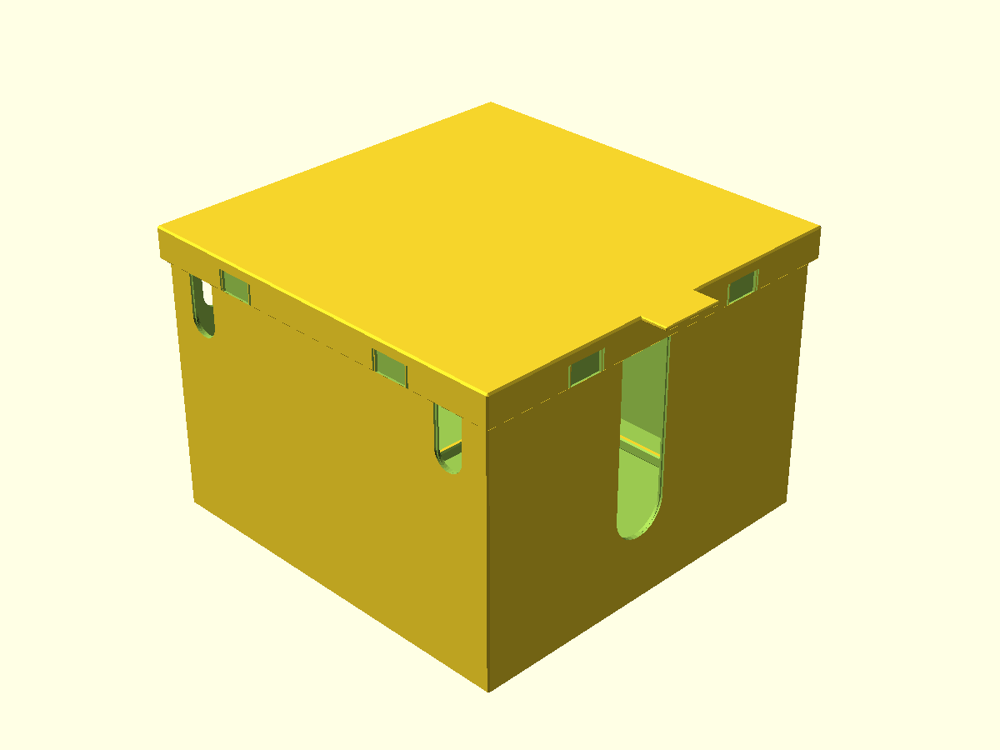
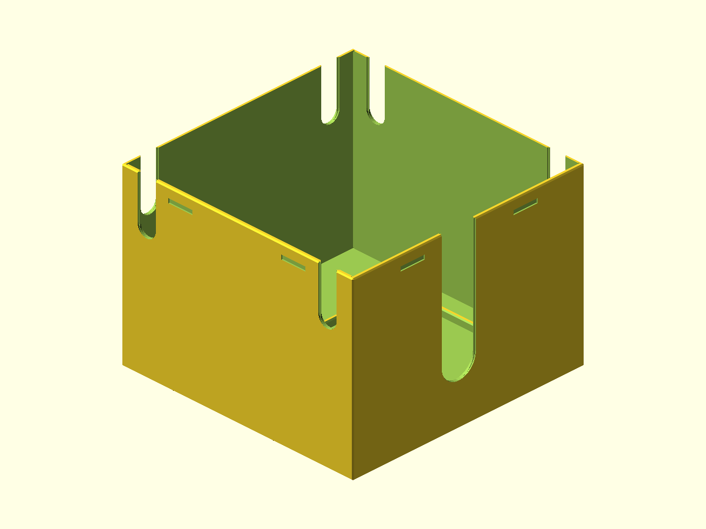
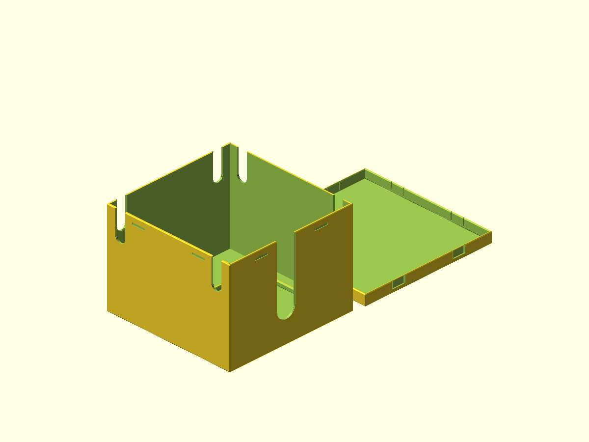

# Cable Box

Parametric 7 x 7 x 5 in internal cable box with a snap-fit lid, pull lip, shifted 4 x 4 in block retainer, one large front-wall cable opening, and six smaller cable notches.

## Dimensions and layout

The specified 7 x 7 x 5 in dimensions are the clear interior dimensions with the lid closed: 177.8 x 177.8 x 127 mm. The retaining frame has a 102.4 mm opening for a nominal 101.6 mm block (0.4 mm clearance per side). The frame is shifted 17.35 mm right and 17.35 mm toward the front. The 25.4 mm-wide front slot is shifted right by the same amount, retaining its 25.4 mm offset from the frame center.

Two 12.7 mm-wide, 40 mm-deep U-notches are placed on each of the back and side walls. All external box/lid/frame edges, cavity transitions, and cable-opening rims have 0.8 mm bevels. The body has 2.4 mm walls and a 3 mm floor; the lid has a 12 mm skirt and 3 mm roof.

The combined print-bed layout places the inverted lid 15 mm beside the upright body. Its 385.8 x 200.2 mm footprint **does not fit a 350 x 350 mm bed**. Each part fits individually: body 182.6 x 182.6 mm and lid 188.2 x 200.2 mm. Export the `body` and `lid_print` modes separately for printing.

## Previews

In the print-bed view, the body floor and lid roof sit flat on Z=0; the lid is inverted with its cavity facing up.

## Mesh audit

| STL | Triangles | Connected parts | Non-manifold edges | Bounds (mm) |
|---|---:|---:|---:|---|
| `body.stl` | 3,320 | 1 | 0 | 182.6 x 182.6 x 130 |
| `lid.stl` | 752 | 1 | 0 | 188.2 x 200.2 x 15 |
| `model.stl` | 4,072 | 2 | 0 | 385.8 x 200.2 x 130 |

## Printing

- Material: PLA.
- Suggested starting point: 0.2 mm layers, 3 perimeters, 15-20% infill.
- The geometry is intended to print without supports; confirm in the slicer, especially around the snap tabs.
- The snap-fit is untested on a physical printer. Adjust `lid_fit_clearance`, `snap_tooth_projection`, and `snap_tab_flex_thickness` after a fit test if needed.
- `model.stl` is the combined print-bed layout; `body.stl` and `lid.stl` are separate-part exports.

## Slicer CLI status

No supported slicer CLI was found on PATH. Creality Print's [official command-line documentation](https://github.com/CrealityOfficial/CrealityPrint#command-line-slicing) documents `CrealityPrint.exe --slice 0 --outputdir <dir> <project.3mf>`. The installed Creality Print 7.2 executable (build 5226) was previously probed with `--help` and `--slice`, but produced no help text or G-code; slicer metrics are unavailable.
